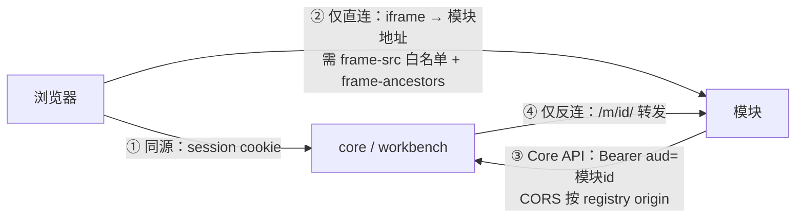

# Unself 架构与契约

> 来源：docs/PRODUCT_SPEC.md v3（2026-09-10）§5/§6/§6.5；docs/requirements.md 第一性原理技术评估（2026-09-06）。

## 可插拔架构图（技术视图）

```
┌────────────────────────────────────────────────────┐
│       Unself Shell（Cloudflare Pages / Docker / 裸机器 / k8s）      │
│  OIDC 会话 · 动态模块导航 · 权限 · 通知 · 配置       │
└──────┬─────────────┬─────────────┬─────────────────┘
       │             │             │
┌──────▼──────┐ ┌────▼─────┐ ┌────▼─────────────┐
│ Module      │ │ Core API │ │ Module Registry  │
│ Registry    │ │/Webhooks │ │ 启停与路由配置    │
└──────┬──────┘ └────┬─────┘ └──────────────────┘
       │             │
       ├─────────────┼──────────────────────────────┐
       │             │                              │
┌──────▼──────┐ ┌────▼──────────┐ ┌────────────────▼─┐
│ chat        │ │ Meeting       │ │ Calendar / Mail  │
│ 可选 Worker │ │ Worker + DO   │ │ 外部适配器        │
│ + DO        │ │ 只做信令       │ │ OIDC/SMTP/CalDAV  │
└─────────────┘ └───────┬───────┘ └──────────────────┘
                        │
             WebRTC P2P 媒体连接（不经过 Worker）
                        │
                可选外部 STUN / TURN / SFU

   文件：可选 R2（CF）/ S3 兼容（自备桶 / MinIO）/ 本地目录（单机默认）
   部署双路径（#101，2026-10-18）：云路径 = installer 专用且扩展；自管路径 =
   Docker/混搭全自管，壳内 URL 接入（#102），installer 非必须
```


### 装载器与壳模块边界

模块契约（字段、权限、身份、token）以 [docs/modules.md](modules.md) 为准。

**装载器**：默认 iframe，所有模块一视同仁（自研模块也住 iframe，逼契约诚实）。契约的原话是“iframe 是默认装载器”，不是“模块必须是 iframe”；将来某个模块要原生体验，可以单独提进壳，契约不动。

**不选微前端的理由**：模块代码一进壳的构建系统，技术栈就绑死了，版本地狱也跟着来；聊天模块是 GPL，不能和核心打进同一个 bundle。用 iframe，模块自己构建、自己部署。


### 单域名路径路由

第一方模块一律同域路径挂载，各自仍是独立 Worker/服务，按路径路由：

```text
team.example.com
├─ /            → Shell + Core API
├─ /m/chat/*    → 聊天模块（独立 Worker，没装就不出现）
├─ /m/meet/*    → 会议信令（独立 Worker + DO，仅在启用时部署）
└─ /m/<其他>/*  → 其余第一方模块

Cloudflare：Workers Routes 按路径绑定
Docker：openresty 按 location 分发，两者等价
```

**安全模型**：不靠浏览器 origin 隔离（同域下也没有），靠 aud 锁定 + 10 分钟短时 token + 模块后端验签。同域共享 Cookie 不碍事：模块后端只认 Bearer，直接忽略 Cookie；第三方 Cookie 被封的问题也就不存在了。

**卫生规则**（由 SDK 自动处理）：路径前缀 `/m/<模块id>/`；存储键前缀 `unself.<模块id>.*`；同源也禁止直接互摸 DOM/存储，一律走 postMessage 契约。

**逃生口**：第三方模块要浏览器级隔离，就在安装时填自己的域名（地址不进清单、不进模块 env，壳从注册表读）。装载协议不变。


### 数据归属与存储

规则：**状态存储归模块，基础设施服务归核心；数据边界靠契约执行，不靠物理分库。**

```text
D1：core 库（用户、角色、模块注册表、会话、审计、setup token）
    modules 库（平台记账表 module_kv + core 落点模块的自建表，表前缀 = 模块 id）
    模块要用 core 的库，连上之后按安装时选定的落点初始化

S3：core 自己的桶。模块连上 core 之后，按安装时选定的落点向 core 初始化，不另做存储适配层
音频：原始录音永不入桶，只存成员本机；云端只有派生文字（转写/纪要）
KV：共享命名空间，键前缀 unself.<模块id>.*
DO：每模块独立 DO 类，存储天然隔离
```

**为什么不分库**：分库才能换来的物理隔离，SDK 前缀收口 + 禁止跨模块外键已经兜住了；要单独导出，按表导出也能做；10 人规模谈不上写入争抢（D1 单写者，日写入千行级）。而分库要吃掉免费额度 7/10（上限 10 库/账户）并复杂化部署编排。边界执行者三件套：SDK 存储接口（模块拿不到裸连接）、禁止跨模块查询与外键（SDK 层拒绝）、按模块版本化的迁移。

**core 为什么单独一库**：登录、权限、审计是平台命脉，值得单独砌一道物理墙——modules 库里哪个模块 purge 出事或者迁移失控，都炸不到 core。代价 1/10 额度。

**模块生命周期接口**（manifest 之外每模块必须实现）：

```ts
export(): Promise<ExportBundle>   // 按表前缀全量导出：JSON + 文件引用
purge():  Promise<void>           // 彻底清除本模块全部表与对象前缀
```

管理员卸载模块三选一：保留数据（默认）/ 导出并删除 / 直接删除。备份 = core 导一次 + modules 按表导出启用模块 + R2 整体，官方提供脚本。

**可逆性**：某模块数据量或写入暴涨时，可将其从 modules 库拆出独立库，SDK 配置切换，模块代码零改动。


### 部署

平台和模块分开装：平台（core 和 workbench）与模块分开安装、分开操作。部署编排与操作步骤见 [docs/deploy.md](deploy.md)，资源初始化见 [docs/flows.md](flows.md)。

**模块包**：官方模块和第三方都是普通 npm 包。worker 依赖打进 `worker.js`。字段表见 [docs/modules.md](modules.md)。清单里的 `storage` 只有 `core` 和 `self`，没有以前的四级。

**部署目标与接入方式（#54/#63）**：一个实例 = 一个逻辑 core。部署只有 CF 这一种要特殊对待——能给它一条路由；其余的只要能连上 core，跑在哪我们不关心。接入只看有没有对外地址：有就直连，没有就反连由 core 转发，跟部署位置和运行体（`runtimes`：`worker` / `node`）都无关。核心留在 CF、模块放自有机器是常见组合，动机是把只有 CF 能做的事（DO / AI）留在免费额度内。接入两种的图见 [modules.md](modules.md) 4.1。

**跨域与 hybrid 可达性（#63/#73）**：模块地址在安装时定——CF 部署时选挂到账号域名（core 建 zone 路由）或 workers.dev 子域（core 开子域），地址由 core 算出；已自己部署好的模块在同一个 tab 里填 id + 地址登记。地址不进清单，也不进模块 env，强制 https（仅 localhost 豁免）。外壳 CSP 的 `frame-src` 按注册表动态生成，模块页必须带 `frame-ancestors`，Core API 按注册表 origin 开 CORS。**「模块恒挂根路径」是不变式**——前缀剥离归宿主（CF wrapper / 反代 / 独立域名各自负责）。四个可达方向：



**控制面与后端解耦（#64/#65）**：装配器写注册表与一次性 setup token 经 `ControlPlane` 接口（CF 直敲 D1 / Docker 走 `node:sqlite`），SQL 与校验收在 core 与装配器共用模块；迁移记账按模块独立（#55 三护栏之一）。

**升级纪律**：已入主的迁移文件永不修改；schema 演进一律新增迁移文件（`000N_*.sql`），`migrations apply` 幂等收敛——替代 M0「直改 init.sql」的做法，真实用户升级不丢数据。运行时进程不持有任何 CF API 凭证。

**运行时启停**：已部署模块由注册表开关控制——`enabled=false` 即边栏隐藏、core 停发对应 aud 的 token，存量 token 10 分钟内自然过期，数据原地保留。新增/移除模块 = 改 config → push → 自动重部署。

**已知缺口**：setup 向导录入的 OIDC client secret 存于 core D1（无字段级加密），审计记录读取行为；字段级加密为远期选项。


#### 第三方模块发布契约

模块作者只发布对应 npm 包即可；部署永远是实例侧动作。

```text
模块作者（独立仓库 / registry）      实例侧（工作台或自己的 Docker）   运行时
┌─────────────────────┐      ┌────────────────────────────┐      ┌─────────────┐
│ npm pack             │      │ 下载这个 npm 包              │      │ 壳 + 模块页 │
│ 产出 npm 包          │─发布─▶│ CF：部署成 Worker            │      │ 同实例共存   │
│                      │      │ Docker：跑同一个包           │      └─────────────┘
└─────────────────────┘      └────────────────────────────┘
```

**模块包内容**：`npm pack` 的产物是什么、每项有什么要求，见 [docs/modules.md](modules.md) §2 包格式。

**信任无分级**：#42 不变——不区分官方/认证/任意，写部署脚本的人 = 信任决策者。但**「无分级」不等于「无信息」**：安装时展示版本、发布者、`sha512`、声明的 `permissions` 与 `storage`，由部署者知情确认。

**模块来源只有 npm 包。** Cloudflare 和 Docker 都是在跑这个包。npm registry、GitHub、内网 tarball 只是部署时从哪下载。下载后不解源码、不执行包里的脚本。

**主题与部署解耦**：模块产物里只有语义令牌名字（`var(--unself-*)`），没有值。部署时零令牌；值只在运行时由壳统一下发（见本文档「注入双通道」）。换主题不重部署模块。

> 完整字段表、`validate` 清单与发布流程见 [docs/modules.md](modules.md)。


### 跨模块协作三原语

会议记录压测沉淀的三条通用机制，所有模块同规适用：

**1. 核心代调与 act claim**：模块互通只走核心。核心代目标模块执行时签发双主体 token：`aud` = 目标模块，`sub` = 发起用户，`act.sub` = 发起模块。目标模块验签后知道“这是会议模块代 Alice 行动”，权限按 Alice 本人在目标模块的权限计算。

**2. 核心通用 ACL**：资源级权限（哪篇文档谁能读写）统一记在 core 库的 ACL 表（资源 URI + 用户 + 读/写位），各模块共用。审计一处、离职回收一处；“参会者天然可读纪要文档”即会议模块经核心写入的一条 ACL。

**3. SDK AI 能力**：模块经 SDK 调 `ai.complete()`，Provider 配置归核心（Workers AI 或外部 API），核心统一路由与记账；模块不自带 AI key。


### 身份与邮箱解耦：能力轴模型（2026-09-10 修订）

身份和邮箱是两根独立的轴，原来「完整实例 / 弱化实例」的二分作废；实例长什么样，就是各能力轴怎么选的组合：

```text
              邮件：无                邮件：Stalwart 全套
身份：内置账号  纯团队空间（默认形态）   「登录归我，邮箱照开」
身份：外部 OIDC 借来协作（仅 OIDC）     完整全家桶（大团队）
```

| 轴 | 取值 | 说明 |
|---|---|---|
| 身份轴 | 内置账号（默认）/ 外部 OIDC | 内置 = 用户名+密码，核心存哈希；OIDC = 外部 IdP，首登 JIT 建档。可并存，按 email 合并同一用户 |
| 邮件轴 | 无（默认）/ SMTP + Provisioning 适配器 | 运行时配置（/admin/settings mail 段），开启即生效免重部署 |

语义差异：邮件轴开启时 Unself 是前门（批准=开号=准入）；关闭时前门在身份轴（内置密码或 IdP 登录，Unself 审批只管档案与通知，事后禁用是自己的门闩）。

密码两用途：登录密码（内置身份）与邮箱密码（邮件轴）是两个密码两个用途；Stalwart 兼任 IdP 时两者合一，是部署巧合，**合一非产品承诺**，Unself 不做密码同步。

Stalwart 适配事实（0.16 调研，2026-09-07）：管理接口自 0.16.0 起 = JMAP
对象（POST /jmap），旧 REST API 已删；应用密码只能本人创建（凭据绑认证
主体，管理员代建在协议层不存在）；禁用 = 摘 authenticate 权限位；删除账
号连带销毁全部邮箱数据，禁用不删是默认语义；Stalwart 侧发信监听 465 隐式 TLS
（0.16 默认移除 587 监听）；OIDC sub = 内部账户 id，删号重建才变，禁用不变。
Stalwart ≥ 0.16.10（JMAP 全合规）为集成前提。

**CF Workers 出站 TLS**：原结论「Workers 内
`secureTransport:'on'` 实际不发 TLS、平台层封死直发」系**归因错误**——`secureTransport` 属
`connect(address, options)` 的**第二参**且默认 `off`，项目自有代码误传在地址参数中
（`core/adapters/mail-smtp/src/smtp.ts`、`app/workbench/src/routes/mail-test.ts`），实际建的是
明文 socket，故「TCP 三握后零字节 / 443 明文 400 / 各端口一致 / Gmail 对照」均由该客户端调用
错误产生，与平台无关。独立探针以官方两参形式实测 465 隐式 TLS 与 587 STARTTLS 均通；
**25 端口为平台硬禁（不变）**；`startTls()` 报错系对 `off` socket 误调，workerd#2712 为另一形态。
**修正后适配器级真实环境投递实测尚未完成（issue #127）**，故产品形态不变：服务端发信=后台尽力
增强（不阻塞审批）、必经通道=邀请页三态自助（docs/flows.md 链路 1 ⑥）。


### 官方模块改编纪律

聊天模块已经在 `app/modules/chat`。它从 EdgeChat 搬进来，许可证仍是 GPL-3.0，出处登记在 `third_party/components.yaml`。不跟上游路线，也不把这份代码打进核心。

**适配深度光谱 L0-L3**（官方与第三方同规适用）：

| 深度 | 形态 | 适用 |
|---|---|---|
| L0 包壳 | 不改上游代码，manifest 包装成模块 | 第三方快速接入、无改造意愿的服务 |
| L1 前端适配 | 主题/导航/入口对齐契约，后端不动 | 现成 Web 应用门面化 |
| L2 契约改造 | 认证与存储对齐（token 验签、SDK 存储、表前缀） | 需要数据隔离与统一身份的服务 |
| L3 深度重写 | fork 后大刀阔斧：删耦合、改架构、自维护 | 聊天模块不在这一档。它是搬进来之后按契约改过的模块 |

**第三方 DX 是产品面**：`@unself/sdk` 的文档和契约示例也算交付物的一部分；「写一个模块放进去」顺不顺，决定这个平台的成色。


## 代码组织：可插拔 monorepo

monorepo 保留，这样核心协议、模块清单、适配器和部署配置能在同一个 PR 里一起改。但第三方完整应用不走 subtree 混进核心代码；它们各自守住构建边界，以模块、服务或适配器接进来。

两桶判据：**`core/` = 开发用的代码依赖（库）；`app/` = 开发好的 app，可被装配**（全部发 npm）。
未就位的模块（docs / board / calendar / git / meeting-p2p 等）按里程碑逐步进 `app/modules/`。

```text
unself/
├── core/                       # 依赖库
│   ├── contracts/              # 模块、身份、权限、通知协议（内部；对外暴露面见 issue #294，未落）
│   ├── sdk/                    # 第三方模块开发 SDK（发 npm：@unself/sdk）
│   ├── ui/                     # 自研 UI 基元（tokens 与组件）
│   ├── control-plane/          # 可复用控制面库（CF REST 客户端 + 资源编排）
│   └── adapters/
│       ├── mail-smtp/          # SMTP 邮件
│       └── provisioning/
│           └── stalwart/       # Stalwart 开户适配器（发 npm：@unself/stalwart-provisioner）
├── app/                        # 可装配的成品
│   ├── workbench/              # 平台运行体（一个包两半边）：src＝core Worker、web＝工作台 SPA、migrations＝SQL
│   ├── installer/              # 部署工具：只把 core 和 workbench 部署到 Cloudflare
│   └── modules/
│       ├── hello/              # 参考模块（发 npm：@unself/hello）
│       └── chat/               # 聊天模块（worker + frontend）
├── docs/                       # 设计真相（产品/需求/架构/链路/决策/路线图/部署/测试）
├── scripts/                    # 仓库级门禁与发布脚本（verify-*.mjs、release/）
├── third_party/
│   └── components.yaml         # 外部组件版本、来源和许可证清单
└── .github/workflows/          # CI 门禁（ci.yml）+ 发布（release.yml）
```

**平台运行体与发行方式**：`app/workbench` 两半边合成**一个** Worker（脚本＝后端，静态资产＝前端构建产物）；产物（`dist/worker.js` + `dist/web` + `migrations`）**随该包发布**，安装器只读 `node_modules/@unself/workbench`，不内嵌、也不从源码树现构建。M1 的独立管理台/门户未定型：现状是 `app/workbench/web` 内的 admin 路由。

**第三方代码引入规则**：
1. 可复用库使用 package 依赖；
2. 独立服务使用发布镜像、HTTP API 或模块 URL；
3. 必须维护 fork 时，优先使用独立 fork 仓库或 submodule；
4. 不使用 subtree 把聊天模块、MiroTalk 的完整历史和源码混入核心；
5. `third_party/components.yaml` 固定版本、来源、构建方式和许可证。

**许可证边界**：

1. **核心选 AGPL-3.0**：自托管产品防“拿代码开托管服务不回馈”的标准答案（Grafana/MinIO/Mastodon 同路）；威胁模型是云厂商白嫖，GPL 看不住托管路径，MIT/Apache 方向就不对。接受代价：AGPL 只强制开源、不阻止竞争性 fork；个别公司贡献政策会劝退贡献者，9 人社区可忽略。用户是唯一初始版权人，接受外部贡献前可随时改许可证或卖商业授权，这扇门目前开着。
2. **边界标注**：根 `LICENSE` = AGPL-3.0 全文（核心/SDK/自研模块/文档）；`app/modules/chat/` 为 GPL-3.0-only（上游继承，manifest 声明 + 根 `NOTICE`/`third_party` 登记，注明含本仓库修改）；MiroTalk 相关件 AGPL-3.0；根 `NOTICE` 记录上游归属；`third_party/components.yaml` 登记每个外部件的版本/来源/SPDX/接入方式；新代码文件头 `// SPDX-License-Identifier: AGPL-3.0-only`（脚手架自动带上）。
3. **合并判定**：代码进同一构建产物才是“合并”。聊天模块是独立 Worker，GPL 代码不进核心构建产物。出处登记在 `third_party/components.yaml`。源码在 `app/modules/chat`。


## 前端约定：主题系统

适用于 `app/workbench/web`（工作台壳）及一切模块前端（含第三方）。

**总纲：统一「名字」和「默认值」，开放「值」。管契约，不管设计。**

### 令牌三层结构

```
primitive 层   品牌自己的值（brand-600、space-4、#2563eb…）→ 主题包里的实物
semantic 层   平台定义的契约名（color-primary、radius-md、space-6…）→ 模块只引这层
component 层  组件接口令牌（button-bg、card-radius…）→ core/ui 内部用
```

模块永远只写 `var(--unself-color-primary)`，手里没有值。

### 语义令牌清单（锁死「只增不改」）

| 类别 | 令牌 |
|---|---|
| 颜色 | bg / surface / surface-hover / surface-active / border / text / text-secondary / text-tertiary / primary / primary-hover / primary-soft / danger / danger-soft / success / info / warning / scrim |
| 间距 | space-1 / 2 / 3 / 4 / 5 / 6 / 8 |
| 圆角 | radius-sm / md / lg / full |
| 字号 | font-size-xs / sm / base / lg / xl / 2xl |
| 阴影 | shadow-card / shadow-pop |
| 其他 | focus-ring |
| 动效（#307 起进契约） | duration-fast / normal / slow / shake / spin / shimmer / wave（#100：6000ms = 走完一整卡高）；ease-out / ease-page-turn（#345：翻页曲线收编，此前仅工作台本地）/ ease-spring；motion-press-scale / motion-lift-y |

规则：**清单发布后只增不改名、不删项**。模块引用它，永远不碎。

> **动效数值骨架进契约**：修订 #43 的口径——时长 / 缓动曲线 / 按压缩放 / 浮起位移等**数值骨架**入语义令牌清单（集中取值防漂移，安装器无构建也同源）；**组合用法仍归模块作者自治**（什么按钮配什么动效、平台不评审）。平台仍只保证静态视觉一致；全部动效带 `prefers-reduced-motion` 降级不变。
> 历史口径存档：2026-09-09 拍板「动效不在契约内」——#307 起以本条为准，原文不改。

### 命名空间

全部语义令牌前缀 `--unself-`：`--unself-color-primary` 而非 `--color-primary`。独立文档内模块自己的 CSS 与令牌不打架；体检/审计可一条规则全查。

### 主题包协议

主题包 = 一份「语义名→值」的 JSON 映射，配 JSON Schema（机器可校验）：

```json
{
  "schemaVersion": 1,
  "name": "handywote-brand",
  "tokens": { "unself.color.primary": "#0f62fe", "unself.radius.md": "6px" }
}
```

规则：
- **部分覆盖合法**：只写自己的键，其余走默认。写主题门槛降到最低。
- **非法值拒绝**：schema 校验不过 → 部署时红，不静默吞。
- **带 schemaVersion**，向前兼容。
- 默认主题包 = 平台内置（今天 tokens.css 的值就是它的内容），是兜底。

### 注入双通道（值怎么进模块页）

```
通道 A（同源直注）  模块挂 /m/<id>/* 同域 → 壳在 iframe 加载后直接向
                   contentDocument 注入 <style id="unself-tokens">
                   手写页（不用 SDK）也自动有值
通道 B（SDK 握手）  模块用 @unself/sdk → ready 握手时壳经
                   postMessage 下发 {type:'tokens', tokens} → SDK 写入 :root
                   标准件自动跟随，模块作者零配置
```

模块页里禁止任何内联值（hello 抄写副本是反面教材），只留 var()。

### 作用域、优先级、生效时机

```
优先级：模块内覆盖 > 实例主题 > 平台默认
边界：模块主题只在模块文档内生效，绝不泄进壳
```

**生效时机**：主题值存 D1 的 instance_config，壳按短 TTL 缓存读取、模块握手时下发当前值。管理员换皮 = 改一条配置 = 实例内模块随下次握手/刷新生效，**不重部署**。

### SDK 主题 API（模块作者权限面）

| 能力 | 形式 |
|---|---|
| 自动跟随 | SDK 标准件默认行为，零配置 |
| 读当前值 | sdk.getTokens()（模块自己写样式时用语义名） |
| 本模块内覆盖 | sdk.applyTheme(partial)——只影响自己文档 |
| 完全独立皮肤 | 不引 SDK 标准件、自写一套 → 允许，体检标注「独立皮肤」 |

### 部署期视觉体检（验产物，不验源码）

- 部署后加载模块页，检查 `--unself-*` 引用是否全部解析成非空值。未解析 = 平台链路坏了，部署时当场红（hello 类 bug 一生一次）。
- 模块零主题引用（独立皮肤）→ 标注「独立皮肤」，不红。
- 不做像素 diff（脆、跨平台字体差异）。标注结果进部署报告。

### 职责边界（管什么，不管什么）

| | 平台管 | 平台不管 |
|---|---|---|
| 令牌 | 契约名 + 默认主题 + 注入通道 | 模块布局/美学 |
| 主题 | 实例主题入口 + 校验 | 模块自定义 skin |
| 体检 | 契约生效标注 | 模块是否跟随（标注即可） |

### 既有铁律（保留）

**1. 组件查找序**：实现任何组件前按序查——

```text
① beUI（github.com/starc007/ui-components，beui.dev/r/{slug}.json
   可机读源码；React 实现移植成 Vue，动效参数照抄：
   时长/缓动/弹簧。用户指定：能用就优先摸）
② shadcn 生态（shadcn-vue / reka-ui，结构基座同源）
③ 都没有 → 手写，样式只取自 tokens
```

**2. 基元内聚**：共享基元（Button/Input/Card/ErrorCard/Skeleton/Icon…）住 `core/ui`，自包含、无外部样式依赖；页面不写一次性样式碎片。

**3. 图标规范**：只用 Lucide（lucide-vue-next，ISC 许可）。manifest `icon` 存图标名，壳白名单映射渲染；界面内禁止 emoji 作图标（用户明确拒绝）。

**界面动线**（shell，M0 范围）：

```text
布局      220px 左栏（顶部实例名 / 中部模块列表 / 底部用户区+退出），
          无顶栏无首页；窄屏 = 底部标签栏（同一份 nav 数据两个渲染器）
setup     部署输出一次性链接才可配置；三字段+测试连接；
          激活成功直接进工作台；已激活后访问 /setup 一律重定向
登录      默认密码表单，实例配置外部 IdP 时并存 SSO 按钮（按配置显隐）；
          登录后回原目标，直访落第一个启用模块
侧栏可见性  停用模块 = 从侧栏消失（成员视角，与七步剧本一致）；
            管理页（M1）列全量含停用
异常      模块加载/失败/过期/被停用各一张卡；成员只见人话+
          request id；管理员登录态可展开技术详情；
          服务端配 wrangler tail + audit_log 串联排查
手机      平台级要求：一切界面 mobile 可用 = 能看 + 轻操作；
          重编辑/重管理允许桌面增强（按操作深度分，不按功能分）
外观      中文写死、亮色单主题、系统字体栈、白灰底+单一主色
hello 页  身份行（token claims 姓名/邮箱）+ 计数按钮并排：
          证明“系统认识你、数据存得住”两件事
```


## 第一性原理技术评估（初版，2026-09-06）

### 架构原则
1. **一实例一团队**：每个团队部署并管理自己的实例；管理员只管理该实例对应的一个团队，不实现团队切换或 Unself 中央租户控制面。
2. **Cloudflare first**：统一壳、模块注册、Webhook、聊天模块和 P2P 会议信令优先运行在 Pages/Workers/Durable Objects。
3. **模块优先于产品套装**：模块有 manifest、依赖、路由、权限和部署目标；未启用即不显示、不创建专属资源。
4. **标准协议优先**：OIDC、SMTP、CalDAV/iCalendar、S3、Webhook 是外部服务边界；不把 Stalwart 写死为平台基础。
5. **实时能力可运行在 CF**：WebSocket + Durable Objects 是聊天和会议小型信令室的默认实现；不把实时能力预设为 VPS 常驻进程。
6. **P2P 媒体与信令分离**：Worker 承载会议鉴权、房间与信令，WebRTC 直接传媒体；TURN/SFU/录制按需放入 Docker 或外部基础设施。
7. **许可证按代码和构建产物隔离**：不通过目录名称假设许可证隔离，必须保留独立依赖、构建和服务边界。
8. **模块契约三通道**：壳与模块之间只有 manifest、`@unself/sdk`、Core API；模块默认 iframe 装载于 `/m/<模块id>/`，第一方同域同规，第三方可在安装时换成自己的独立域名，契约不变；安全靠短时 token 验签，不靠 origin 隔离。
9. **资源**：模块 env 只放 core 地址和接入码。用 core 的哪一类资源由安装时选定（registry `storage_level`：`core` / `self`），模块启动后用 key 连上 core，按选定落点初始化。模块自己的库和桶归模块自己管。
10. **平台与模块分开部署**：安装器只部署 core 和 workbench。模块在平台起来之后再装。运行时进程不长期持有 Cloudflare 凭证。
11. **跨模块协作走核心**：模块互通只经核心代调（act claim 双主体）；资源级权限记核心通用 ACL；AI、存储等基础设施能力由核心配置、SDK 供给。

### 技术选型与复用调研（v2：二次开发缝合路线）

> 用户决策：不是部署现成产品，而是**二次开发把模块组合成一套精简产品**。

| 模块 | 官方默认实现 | 可替换/外部实现 | 二次开发重点 |
|---|---|---|---|
| 统一壳 | Vue3/React 单页壳，CF Pages/Workers | Docker 静态/Node 部署 | OIDC 会话、动态导航、模块加载、通知中心 |
| 身份 | 通用 OIDC | Stalwart、Keycloak、Authentik 等 | claim 映射、团队角色、模块权限 |
| IM | 聊天模块 `@unself/chat`，已在 `app/modules/chat` | 其他聊天实现 | 模块 token、逐条已读 |
| 日历 | CalDAV/iCalendar 适配器 | Stalwart、Nextcloud、其他 CalDAV | 响应式前端、会议/任务联动 |
| 看板/任务 | 自研轻量模块 | 外部任务系统适配器 | 看板和日历联动 |
| Markdown 文档 | 自研模块 + Milkdown/Tiptap | 外部文档系统适配器 | 内容、评论、权限 |
| 会议 | CF Worker + DO WebRTC 信令 | MiroTalk、其他信令服务 | 房间权限、信令协议、日历联动、录音/转写/纪要输出 |
| 文件 | S3 兼容适配层 | R2、MinIO、用户自备桶 | 上传授权和对象引用 |
| 邮件 | SMTP 适配器 | Stalwart、其他 SMTP | 通知、可选开户/停用适配器 |
| Git 动态 | CF Webhook Worker | Gitea、GitHub、GitLab | 事件规范化和模块投递 |

### 聊天模块现状

> 基准 commit 29978c2（2026-09-15，v2.7.0）。
- ✅ 实时：Durable Objects WebSocket Hibernation，这就是现在的聊天模块。
- ✅ 群聊/私聊/语音消息/文件/头像/历史分页/@提醒/封禁。
- ✅ 文件可以落在 core 的 S3；`storage=self` 时用自己的桶。
- ✅ 管理后台、邀请和用户管理能力。
- ⚠️ 已读未读只有频道级游标，无逐条“已读 x/y”回执，需二次开发。
- ⚠️ 原生认证是本地账号体系，需接入通用 OIDC。
- ⚠️ 包含或修改其代码的模块必须独立遵守 GPL；未使用聊天模块的实例不部署其资源。

### 部署拓扑（Cloudflare 首选，单域名）
```
team.example.com（部署者自己的 Cloudflare 账户）
 ├─ /              → Shell + Core API / Module Registry（Workers）
 ├─ /m/chat/*      → 聊天模块（可选）
 ├─ /m/meet/*      → P2P 信令（可选：Worker + DO）
 ├─ /m/<其他>/*    → 其余第一方模块，按路径挂载，未启用不部署
 └─ 附件           → 可选 R2/S3/MinIO

外部可选服务（独立域名，不属于实例）：日历 CalDAV、邮件 SMTP/邮局
Docker / 外部扩展：TURN、SFU、录制、MiroTalk、完全私有化部署
 openresty 按 location 分发，与 Workers Routes 等价
```

### 本团队参考部署
- Stalwart 同时提供 OIDC、SMTP 和 CalDAV；这是官方示例，不是产品要求。
- Gitea 通过 Git 适配器发送 Webhook；聊天和邮件模块是否消费事件由当前实例配置决定。
- openresty、Tailscale 和 NAS 备份属于本团队运维方案，不进入 Unself 核心依赖。

