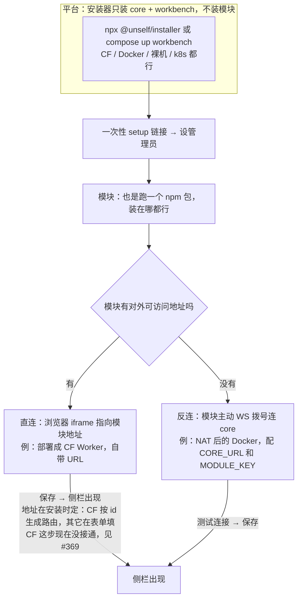

# Unself 核心端到端链路（模块组合）

> 来源：docs/PRODUCT_SPEC.md v3（2026-09-10）§4。

## 链路 0：部署到出实例

平台和模块分开装。安装器只装平台。操作步骤见 [docs/deploy.md](deploy.md)。



没设管理员之前，谁拿到那条一次性链接，谁就能接管这个实例。

平台和模块各自升级。重跑安装器或重拉 workbench 容器，只动平台。模块的装、换、卸不改 core 的产物。

## 链路 1：新人入职（2026-09-10 修订：双门·注册矩阵·门型表）

**门型这块是拍过板的**：入职入口保留邀请制，不做开放注册。

门型与注册矩阵见 [docs/requirements.md](requirements.md) §1。

**双门是这么个意思**：邀请链接管的是「谁能填表」，审批管的是「谁能进门」。链接泄露了，最多多出一条待审批申请，真正的门在审批那儿。

```
① 管理员部署 Unself（默认内置身份，可接外部 OIDC）；
② 平台起来之后再装模块（工作台里用 CF token 建成 Worker，或自己 Docker 起模块再连上）；没装的不出现在侧栏；
③ 管理员生成邀请链接（一次性/限期）分发给新人；
④ 新人打开链接填表（内置模式含用户名+密码；邮件轴开启时含邮箱前缀+个人邮箱）提交；
⑤ 管理员批准（桌面主入口，手机响应式同页）：
   邮件轴开启：Stalwart 适配器 JMAP 开户（随机初密）+ 后台尽力发信
              （一次性令牌+邮箱所有权双证，只设邮箱密码；发信失败不阻塞审批）；
   邮件轴关闭：无开户动作；
⑥ 激活交付：邀请令牌持有者=被邀请人本人，激活权跟随邀请令牌；
   必经通道=新人凭邀请链接回邀请页看三态（待审批/已批准→设置邮箱密码/已激活→去登录），
   claim 原子重签（单一有效链接、明文不落库）；邮件只是尽力增强，不是必经；
   内置无邮件模式：批准即激活，新人直接登录（注册时设的密码已随申请入库）；
   OIDC 模式：成员首登，JIT 建档并消费邀请记录；
⑦ 成员进入统一工作台，只看到已启用且有权限的模块；
⑧ Gitea、日历等外部系统通过标准协议或适配器接入（Git 联动在 M3）。
```

产品原则：Unself 是给任何团队自托管的产品，本团队这个实例只是其中一次部署。
跟实例相关的值（邮箱域名、发件地址、OIDC 地址）统统进部署配置，不写死在代码里。
账号移除 = 把 authenticate 权限位摘掉做个禁用（数据保留），真要删除，那是链路 6 完整版里的事。

邮件是两根轴，存在 `mail_stalwart`（开户）和 `mail_smtp`（发信），不再用原来那一行 `mail`。读设置走一次 `GET /api/admin/settings`。`enabled` 必须显式为 true 才算开，缺省当关。邀请状态同时返回 `mailEnabled` 和 `smtpEnabled`。工作邮箱前缀只跟开户轴走；个人邮箱在任一轴开着时必填。只开了发信、没开开户时，前缀可以不填，个人邮箱仍要填，否则没有收件人。设置页是三行：OIDC、邮箱管理、通知发信。过程在 issue #340。

## 链路 2：一条消息的"已读回执"（二次开发核心）

```
① A 在群聊发消息
② 聊天模块把消息广播到在线成员的 WebSocket
③ 每个客户端"看到"该消息时上报已读（前端可见性检测触发）
④ DO 写 read_receipts 表（message_id × user_id）
⑤ 推送"已读状态变更"事件 → 所有成员 UI 更新
   "已读 3/5"（飞书式逐条回执）
⑥ 离线成员上线后补拉历史消息 + 回执状态
```

频道级未读仍用 `message_reads`。逐条回执是另一张表 `read_receipts(message_id, user_id, read_at)`，主键就是这两列，和频道游标并存，互不改写。

`已读 n/m` 的分母是这条消息的可达收件人：房间里未删、仍 active 的成员，去掉访客和停用的人，再去掉发件人。发件人算已读，不进分母。私聊分母是 1，已读就是 ✓✓。

上报走 HTTP：`POST /api/messages/read`，一批最多 200 条，`INSERT OR IGNORE`，没进这个房间的人 403。不走 WebSocket 上行。有新行才广播一帧 `read_receipts`（带 `messageIds[]`），重复上报不产生事件。拉历史时，分页结果里每条消息带 `readReceipts{count, readBy[], total}`。已经连上的 socket 要换 token，走控制帧 `{type:'token_refresh', token}`，验过再换绑；新 token 无效就关连接。过程在 issue #217、#220。

## 链路 3：创建会议（日历 → 邀请 → P2P 视频 → 会议记录）

```
① A 从消息、日历或工作台创建会议，填写时间和参会人；
② 日历模块通过 CalDAV 或 iCalendar 适配器创建/同步日程；
③ 如果邮件能力已启用，由配置的 Mail Provider 发送邀请，否则使用站内通知；
④ 到达会议时间，成员点击日程中的“加入会议”；
⑤ 统一壳向 Cloudflare Worker 请求会议房间，并通过 Durable Object 建立房间状态和 WebSocket 信令；
⑥ 浏览器交换 SDP 和 ICE Candidate，优先建立浏览器之间的 WebRTC P2P 媒体连接；
⑦ Worker 只承载鉴权、房间状态和少量信令，不承载音视频流量；
⑧ 直连失败时，可由部署者配置外部 STUN/TURN；需要 SFU、录制或大规模会议时，再接入独立服务；
⑨ 会议中每个成员只转写自己的麦克风音轨：普通会议可用浏览器云转写，机密会议由主持人强制完全本地转写或不转写；片段带房间时钟时间戳，成员可 opt-out；
⑩ 散会后各成员只上传纯文字片段（无音频），会议 Worker 按房间时间排序合并成完整记录；再按配置生成 AI 纪要，并输出到 Markdown 文档（经核心代调）、通知或邮件。
```

### 会议记录与 AI 纪要

核心原则一句话：**音频存档永远不上云。** 录音只待在成员本机（可以手动导出，不备份），服务器上只有派生出来的文字。

```text
转写通道（主持人建会时选定，成员只读声明）：
├─ 普通会议：浏览器实时云转写（Web Speech API 等，免费，音频流瞬时过第三方）
├─ 机密会议：强制完全本地（量化 Whisper，WASM/WebGPU），或不转写
└─ 任何成员可 opt-out 自己的转写，缺失即缺失
```

每个人只转写自己的音轨，说话人是谁天然就清楚，不需要什么说话人分离模型。时间轴统一用会议 DO 的房间时钟：成员加入时领一次时钟偏移，之后本地自己打房间时间戳；散会后只上传纯文字片段（10 个人大概 200KB），由会议 Worker 排序合并，主持人一点手工活都不用做。

云端数据和权限是这样分的：

```text
合并记录    全体参会者可读，主持人独占可写
个人片段    参会者互相可见（本人上传的原话逐字稿）
AI 纪要     经 SDK AI 能力（ai.complete()）生成，归会议模块
```

文档联动：文档模块启用着的话，纪要经核心代调写进文档（act claim 上标着“会议代 Alice 创建”），参会成员天然拿到这篇文档的读权限，主持人拿到写权限（记进核心的通用 ACL，见 docs/architecture.md 里跨模块协作的三原语）；文档模块没启用，纪要就留在会议模块里。禁用或离职时的权限回收是即时生效的。

录音、转写和 AI 处理这些事，会议开始前都会明确提示；管理员也可以按实例策略把云转写通道关掉。

## 模块怎么拿到资源

core 不管理模块的 env。env 是模块自己填的。

用哪一类资源不写在 env 里：安装时选定落点（`core` / `self`）。

模块启动时，先用 env 里的 key 向 core 校验并连上。连上之后，按选定落点调用 core 的能力，把对应资源初始化好。连接信息不用写进 env，向 core 要。

模块自己的库、自己的桶，或其他外部服务，也写在同一份 env 里。这些 core 不代管，也不帮初始化。

文件和附件一样：声明了用 core 的，连上之后走 core 的能力；用自己的，就读自己 env 里的地址。业务数据只存对象引用。

## 链路 5：Gitea 联动（通知内部化）

```
① Gitea、GitHub 或 GitLab 发送 Webhook；
② Git 适配器验证签名并转换为统一事件；
③ 如果启用了聊天模块，事件发送到 Git 动态频道；
④ 如果启用了邮件模块，事件可发送邮件通知；
⑤ 未启用对应模块时，事件写入审计日志或直接丢弃，不能依赖某个固定邮局。
```

## 链路 6：离职处理

```
① 管理员在管理页停用本团队成员；
② 核心权限服务立即撤销该成员的模块访问权；
③ 已配置的模块收到成员停用事件并清理会话；
④ 如果配置了 Provisioning 适配器，再调用对应系统禁用邮箱、应用密码或账号；
⑤ 可选：按本团队的策略归档成员数据。用 core 的库或 S3，还是用模块自己 env 里的存储，跟上面同一套。
```
