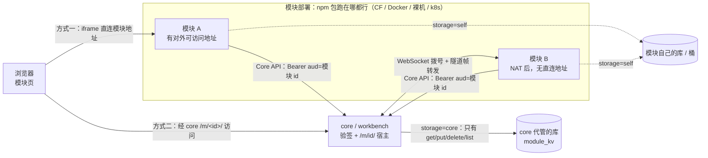
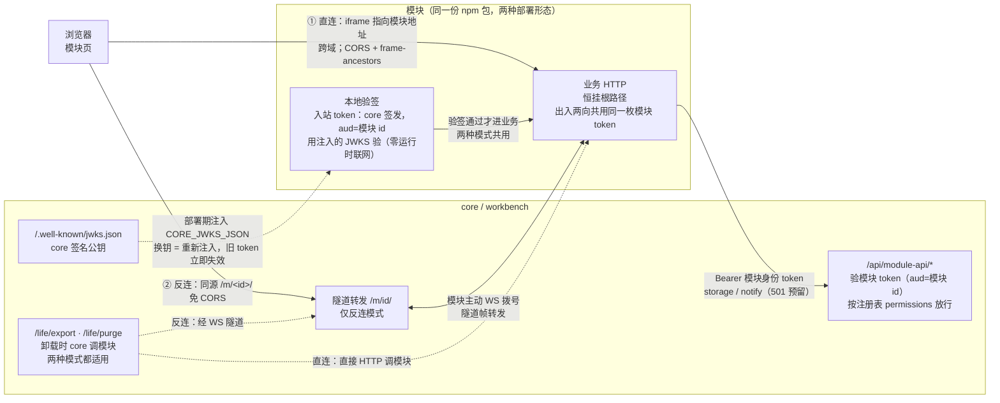

# 模块契约与开发指南

> 这篇文章给两种人看：一种是写模块的人（第三方和官方守的是同一套规矩），一种是部署模块的人。
> 模块包契约的权威说法就放在这儿。部署怎么编排、装配器怎么干活，去看 [docs/architecture.md](architecture.md)。拍板过程在对应 issue 和 PR，不另开决策档案。
> 状态：契约 v1，2026-09-17 定稿。标着「待定」的条目还没定案，别照着它去实现。

## 0. 一句话

模块说白了就是一个自包含的部署单元。它靠三条通道跟壳协作——manifest、`@unself/sdk`、Core API；壳对模块内部怎么实现的，一概不管。

按形态分，模块有三类。这和包无关，包都是 npm 包：

| 类 | 是什么 | 例子 |
|---|---|---|
| 功能模块 | 原生 Worker 实现的协作能力，随实例部署 | 聊天、会议信令、看板 |
| 适配器 | 代码随实例部署，包一层外部系统 | Stalwart（邮件）、CalDAV（日历）、Git Webhook |
| 伴生服务 | 实例外的整台服务，只做配置接线 | Stalwart 本体、外部 IdP、TURN/SFU |

## 1. 来源与身份

模块只有一种东西：npm 包。Cloudflare Worker 和 Docker 都是在跑这同一个包，不是两种来源。

身份是包名，例如 `@acme/unself-todo`；`manifest.id` 只是默认命名来源，不是身份（见第 3、8 节）。官方模块也是普通 npm 包（`@unself/hello`、`@unself/chat`），没有另一条来源。

npm registry、GitHub、内网 tarball 不是模块来源。那是部署时从哪把这个 npm 包拿下来。拿到的都是同一个包，然后要么部署成 Worker，要么放进 Docker 跑。

包必须已经打好。部署时不解源码、不跑包里的脚本。

## 2. 包格式

包是 `npm pack` 打出来的 npm 包，没有单独的打包器：

```
unself-todo-1.2.0.tgz
├─ manifest.json     契约声明（唯一必需，见第 3 节）
├─ worker.js         预构建、自包含；runtimes 含 worker 时必需
├─ assets/           模块页静态文件；只含 var(--unself-*) 名字，不含值
├─ migrations/       可选：000N_*.sql，在 core 里自建表时用
├─ config.schema     可选：配置页字段声明（见第 5 节）
├─ theme.json        可选：模块自己的皮肤（默认跟随实例主题）
├─ docker/           可选：模块以 Node 运行体跑在容器里时的镜像/端口/健康检查参考；壳不消费，只供复制
├─ LICENSE / NOTICE  许可证随包走；GPL 类模块必须自带
└─ package.json      作者自己的 npm 元数据；`npm pack` / `npm publish` 用它
```

`manifest.json` 才是**安装侧认的真相**；那份生成的 `package.json` 只是拿去发 npm 用的，两边的版本号必须对得上。

**包里绝对不能放**：`node_modules/`、`.env` 或密钥、测试残留、源码。

**`worker.js` 也有要求**：单文件、自包含——所有依赖都得 bundle 进产物。部署的时候是零安装，运行时也没有任何动态装包的机制。

## 3. manifest.json 字段表（契约 v1）

| 字段 | 类型 | 必需 | 说明 |
|---|---|---|---|
| `id` | string，`^[a-z][a-z0-9-]+$` | ✅ | 默认命名来源（npm 包名缺省、tarball 名、Worker 脚本名）。**不是实例身份**——实例 id 由 core 定，见第 8 节 |
| `version` | semver `x.y.z` | ✅ | 版本 |
| `runtimes` | `worker` / `node` 的子集 | ✅ | 本模块能跑在哪：`worker` = workerd，`node` = node 进程。接入方式由地址决定，和运行体无关 |
| `route` | string，以 `/m/` 开头 | ✅ | 挂载路由建议值；同域路径制下由装配器生成 `/m/<id>/*` |
| `permissions` | 能力词表子集（见下） | — | 向平台要的权限。没声明就调对应 Core API → 403 |
| `storage` | `{ accepts, preferred?, declaration? }` | — | 只有 `core` 和 `self`。省略 = 只支持 `self` |
| `tables` | string[]，`^[a-z][a-z0-9_]*$` | — | 自建表的表名。写了就必须 `accepts` 含 `core`，且不能把 `declaration` 选成 `self` |
| `config` | 字段数组（见第 5 节） | — | 工作台设置页要填的项 |
| `compat` | `{ "min": "1.0", "max": "1.0" }` | — | 契约版本区间，`x.y`。省略 = 接受任意版本 |
| `description` | string | — | 壳上展示的一句说明 |
| `icon` | `^[a-z0-9-]+$`（Lucide 图标名） | — | 不认识或没写，回退成模块名首字。不要 emoji |
| `coreOrigin` | string | — | 跨域时壳的 https origin。禁止 `*` |
| `license` | SPDX 表达式 | — | 不写则按 AGPL-3.0-only |

地址不写在清单里，也不写在模块的 env 里（env 只有 core 地址和接入码）。模块地址是**安装时的产物**，三种来法都是「直连」（#369）：装成 CF Worker 时选挂到账号下已有域名（core 建 zone 路由，地址 = `https://<domain>/m/<id>/`）或 workers.dev 子域（core 开脚本子域，地址 = `https://<script>.<account>.workers.dev/`），地址由 core 算出写进注册表，管理员不填；模块已经自己部署好、有可达地址的，在同一个 Cloudflare 部署 tab 里选「我已有地址」，只填模块 id + 地址登记（清单落占位，当前没有自报清单的通道，列表里看不到版本/图标）。壳从注册表读这个地址当 iframe src；反连则由 core 记成自己的 `/m/<id>/`。

> **icon 字段规则**：manifest 存图标名而非图标资产，由壳内置的 lucide-vue-next 统一渲染（白名单映射，按需打包）；模块不自带图标文件。未来模块需要品牌标时再议 `iconUrl` 可选字段，暂不设。

权威校验是 `core/contracts/src/manifest.ts` 里的 `ModuleManifestSchema`。

**`permissions` 词表**（第一版，权威定义在 `@unself/contracts`）：`storage` / `acl` / `notify` / `ai` / `realtime` / `mail`。
**碰上不认识的能力，安装时就直接拒掉**——要是悄悄忽略，模块跑起来会莫名其妙地 403，部署者压根查不出原因（这是沿用 #64 已经立下的原则）。

**已经删掉的字段**：`capabilities`（模块「提供什么功能」这件事不归 core 契约管，放错层了）和 `requires`（永远是恒定值，也没人消费）。等真需要表达「这个模块实现的是哪项产品能力」时再按增量补，现在别预留。

## 4. 部署位置与数据落点

**部署位置是部署者选的，模块只声明自己能跑在哪**。接入不由位置决定，只看模块有没有对外地址：

| 接入 | 判据 | 谁转发 |
|---|---|---|
| 直连 | 安装时给了地址 | 不转发，壳把模块页当 iframe 指过去 |
| 反连 | 没有地址 | core 转发（`/m/<id>/`） |

模块没声明支持的运行体，就**直接拒绝安装**，不让它跑到一半再炸。

### 4.1 跑在哪，和「谁转发请求」不是一回事

**一句人话**：部署方式随便挑，契约只认两件事——壳能不能把请求送到模块（接入方式），以及模块怎么证明自己是自己（认证，见第 8 节）。



两条路的模块认证完全一致，换接入方式不改模块代码；反连下 core 是所有模块流量的中转，流量大的模块更适合直连。

**数据落点只有 `core` 和 `self`。**

```jsonc
"storage": { "accepts": ["core"], "preferred": "core" }
```

| 值 | 含义 |
|---|---|
| `core` | 核心代管。键值走 Core API；要自建表就在 `tables` 里申报 |
| `self` | 模块自己管存储。省略整个 `storage` 就等于只支持 `self` |

`preferred` 和 `declaration` 都必须是 `accepts` 里的一项。以前的 `shared` / `dedicated` / `external` 已经不在契约里。

## 5. 配置页（config schema）

`config` 只是声明模块自己的 env 里有哪些项。没有安装器向导去渲染这张表。

```jsonc
"config": [
  { "key": "DATABASE_URL", "label": "PostgreSQL 连接串",
    "type": "secret", "required": true, "test": "pg" },
  { "key": "REGION", "label": "区域", "type": "enum",
    "options": ["us", "eu", "ap"], "default": "ap" }
]
```

| 字段 | 说明 |
|---|---|
| `key` | 环境变量 / secret 名 |
| `label` | 中文标签（部署者看到的就是这个） |
| `type` | `string` / `secret` / `number` / `boolean` / `enum` / `url` / `json` / `oauth` |
| `required` | 是否必填 |
| `default` | 缺省值 |
| `options` | `enum` 的候选 |
| `test` | 可选的连接测试标识（如 `pg` / `s3` / `http`） |

**配置写在模块自己的 env 里**，core 不代填。用 core 的哪一类资源不写在 env 里——它在安装时选定（注册表 `storage_level`：`core` / `self`）。模块启动后用 key 连上 core，再按选定的落点初始化。

## 6. 迁移契约（硬）

这些只对在 `core` 里自建表的模块有意义（`tables` 有申报）。`self` 的库由模块自己管，不走这里。

1. **逐条幂等**：记账表只在**整份文件跑成功之后**才记账，失败了再重跑，会**整份重放**——所以 `CREATE TABLE/INDEX` 必须带 `IF NOT EXISTS`，`INSERT` 必须用 `OR IGNORE` / `OR REPLACE`。
2. **只写增量安全的语句**：`CREATE` / `ADD COLUMN` / `CREATE INDEX`。破坏性变更走 expand/contract（先加新表新列 → 迁数据 → 弃用旧的，但别删）。
3. 表名以 `<模块id>_` 开头；不许跨模块建外键；迁移文件命名成 `000N_描述.sql`，**只增不改**（改了也不会重跑）。

## 7. 打包与发布

没有单独的打包器。作者在自己的仓库里构建好产物，用 npm 自己的命令打包、发布：

```sh
npm pack
npm publish
```

发出去的是 npm 包。工作台用 CF token 把它部署成 Worker，或者你用 Docker 跑同一个包。npm registry、GitHub、内网地址只决定从哪下载这个包。

### 7.1 热更边界

模块可以热更：把模块 Worker 重新上传一份就行，**core 不用停机**。边界有三条：

1. **已经打开的页面得刷新**才能拿到新资产（资产哈希变了）
2. **模块迁移必须向后兼容**（记账按文件名走，只有新增才是安全的——见第 6 节）
3. **契约版本或权限声明变了**的时候，核心会在装配期重新签发 module-token（同样不用重启核心）

装的是这个 npm 包的一个版本。升级要显式换版本，不会在重跑时偷偷换包。

## 8. 运行时契约

通道总览：



图里画不出的约束写在下面：

- **身份**：模块只认 core 签发的短时 token（`aud` = 模块 id），本地验签，运行时不用联网取钥；公钥是装配器在部署期通过 `vars.CORE_JWKS_JSON` 注进去的。

  规则只有一条：**全系统只有核心对接外部 OIDC，模块只认识核心。**

  ```text
  ① 成员在壳完成外部 OIDC 登录（PKCE），会话 Cookie 只在实例域名上
  ② 壳装载模块 iframe，模块 SDK 向壳发 ready 消息
  ③ 壳调核心 POST /api/modules/:id/token（核心校验模块启用与用户权限）
  ④ 核心签发模块 token，壳经 postMessage 交给 iframe（targetOrigin 校验）
  ⑤ 模块后端用核心 JWKS 验签、校验 aud，接受 Bearer 请求
  ⑥ token 过期前 SDK 静默续期，成员无感
  ```

  | 参数 | 取值 | 理由 |
  |---|---|---|
  | 形态 | 核心签名的 JWT | 一个 JWKS 全平台通用，模块只需验签，不需懂 OIDC |
  | aud | 实例 id | token 不能跨模块重放（见第 8 节「实例 id」） |
  | 有效期 | 10 分钟 + 静默续期 | 短时效是主要吊销手段 |
  | sub | 核心内部稳定用户 id | `issuer + sub` 映射留在核心，换身份源不影响模块数据 |
  | 交付 | postMessage 握手 | 不进 URL、不进 Cookie、不进日志 |

  **踢人**：成员停用时核心停发模块 token 并广播停用事件（registry 停用；生命周期导出/清理走 `GET /life/export`、`POST /life/purge`）；10 分钟 token 过期作为兜底上限。

  **登出**：壳清会话并广播登出消息，模块丢弃 token。外部身份源的 SLO 暂不做，标记为远期。
- **模块后端面（Core API 代理）**：模块带上 `Authorization: Bearer <模块 token>` 去调 `/api/module-api/*`；权限的真值取的是**服务端注册表快照**里的 `permissions` 声明，**没声明就调用 → 403**。目前有的端点：
  - `GET` / `PUT` / `DELETE` `/api/module-api/storage/:key`、`GET /api/module-api/storage/`（列键）= `core` 落点的 get/put/delete/list 四个形状
  - `POST /api/module-api/notify` = `notify` 那个词（站内通知，`module_notify` 类型；模块触发通知不直接发邮件）
  - `acl` / `ai` / `realtime` / `mail` 这四个词**门禁已经生效，但端点还没实现**（`501` 预留）
  - 落地与收敛：端点和 `module_notify` 由 #243 落地；`@unself/sdk` 客户端的收敛（把「SDK 直连 D1」和「Core API 代理」两条并存的路收成一条）归 **#248**。
- **`coreOrigin` 必填**：跨域的模块必须显式配置，**不许回落到 `'*'`**。
- **模块永远挂在根路径**：模块代码就按「部署在根路径」来写；`/m/<id>/` 这个前缀由**宿主**剥掉（CF wrapper / 反代 / 独立域名本来就挂根）。模块自己不要实现前缀逻辑。
- **CSP / CORS**：自托管的模块页必须带 `frame-ancestors <壳的 origin>`；Core API 按注册表的 origin 白名单放行。
- **SDK 只有一种用法**：`import { x } from '@unself/sdk'`——普通依赖，跟模块自己的构建和 `dependencies` 走。平台不注入、装配器不拷、模块不自带副本。
- **健康检查**：`GET /api/health`（冒烟和可达性体检用）。
- **生命周期**：`GET /life/export`、`POST /life/purge`（卸载时「导出并删除」/「直接删除」用）。
- **反连宿主**：`@unself/sdk/host`。进程环境变量 `UNSELF_CORE_URL`、`UNSELF_MODULE_KEY`，可选 `UNSELF_MODULE_ADDR`。不读 `.env` 文件，文件加载交给调用方。
- **实例 id**（下文与图示里的「模块 id」同义）：注册时定死，落注册表 `module_registry.id`（反连 = 管理台填的 id，CF = 装配器按表单/包名生成），`/m/<id>/`、隧道分片、`aud`、存储记账、审计全用它。`manifest.id` 只供默认命名，部署者可覆盖（见第 3 节）。**模块不得硬编码自己的 id**：反连模式下由握手响应 `POST /api/modules/connect-manifest` 的 `{ id }` 下发，`@unself/sdk/host` 负责交给模块；CF 部署态模块不需要知道外部 id。
- **core → 模块的两条入站路径**：直连（按注册表里存的模块地址指过去）和反连（core 转发隧道帧）。模块只实现普通的 HTTP 处理，不知道请求走的是哪条——前缀 `/m/<id>/` 由宿主剥掉（见第 4.1 节）。

## 9. 兼容与升级

- 契约版本（`CONTRACT_VERSION`，跟产品版本是两回事）**只在破坏性变更时才 bump**；增量变更不拦人（新字段有默认值、新能力进词表、新端点老模块不调用就行）。
- `compat` 省略 = 接受任意版本。注册表里记着「安装时的契约版本」，core 升级时据此发现潜在的破坏 → 停用该模块并给出提示；`--allow-incompatible` 可以硬上。
- **发版约定（破坏性变更怎么定义、弃用周期、谁来 bump、CI 卡点）待定。**

## 10. 待定

| 项 | 归属 |
|---|---|
| `permissions` 词表的对外可见面（首版 6 项） | 由 `@unself/sdk` 具名导出 |
| 发版约定细节 | 留档待定 |
| chat / meeting 模块对 DO 的依赖在 Node 运行体上的平替（core 自己的反连隧道已平替：Node 运行体里同一份 `TunnelRoom` 经薄适配层跑；模块侧的 `ChannelRoom` / `Scheduler` / `UserInbox` 是 SQLite-backed DO，要平替得先给模块一套本地存储与消息广播，不是换个 WebSocket hub 的事） | 下一阶段，落地前这两个模块 manifest 如实只写 `worker` |
| `oauth` 类型配置字段的交互细节 | 下一阶段 |
